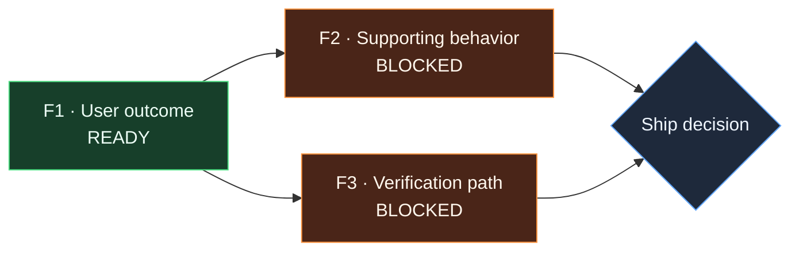

# Mira Concierge Pilot — Pilot X / PXX

_Date started: YYYY-MM-DD · real repository: Yes · identifying details omitted_

This session tests whether an executable, evidence-bearing feature graph improves coordination and ship decisions. It does not test visual polish, automatic graph generation, managed inference, or generalized project management.

## Feature outcome

**User-visible or system outcome:**

**Why this feature matters now:**

**Participant's normal workflow:**

## Baseline

Measure before creating the graph.

| Measure | Baseline |
|---|---:|
| Time to identify first safe agent task |  |
| Time normally spent reconstructing status after an agent finishes |  |
| Time normally required to make a ship/blocked decision |  |
| Confidence in current ship criteria, 1–5 (secondary) |  |

**Participant's initial answer to “What must be true before this feature can ship?”**

## Visual feature graph

Replace the example nodes with three to eight feature blocks. A node is ready only when every dependency is verified or explicitly waived. Mermaid is the pilot surface; the founder may prepare it manually with the participant.

## Feature-block registry

| Block | Outcome | Depends on | State | Bounded owner | Allowed scope | Changed files | Evidence required | Evidence observed | Unresolved risk |
|---|---|---|---|---|---|---|---|---|---|
| F1 |  | None | Ready |  |  |  |  | None |  |
| F2 |  |  | Blocked |  |  |  |  | None |  |
| F3 |  |  | Blocked |  |  |  |  | None |  |

Allowed states: **Draft**, **Blocked**, **Ready**, **Running**, **Needs review**, **Verified**, **Failed**, **Waived**. A block may be **Verified** only when its required check has evidence.

## Dependency registry

At least one edge must be load-bearing. If changing an edge condition would not change readiness, permission to start, or the ship decision, record that the graph was unnecessary.

| Edge | From | To | Readiness condition | Fallback when unmet | Decision changed? |
|---|---|---|---|---|---|
| E1 | F1 | F2 |  |  |  |
| E2 | F1 | F3 |  |  |  |

## Agent and evidence log

| Time | Block | Agent action | Result | Evidence inspected by participant | Graph change | Maintenance minutes |
|---|---|---|---|---|---|---:|
|  |  |  |  |  |  |  |

Record only actions that change what is safe to do next or whether the feature can ship. Do not treat “agent finished” as evidence of correctness.

## Observed decision metrics

For comparable measures, calculate improvement as `(baseline − graph) / baseline × 100`. Mark the result inconclusive when the baseline is estimated, the tasks are not comparable, or the participant required facilitator rescue.

| Measure | Graph workflow | Change from baseline |
|---|---:|---:|
| Time from brief to first safe agent task |  |  |
| Time to identify next safe task after agent completion |  |  |
| Time from last agent result to ship/blocked decision |  |  |
| Total graph setup and maintenance time |  | n/a |
| Duplicate or dependency failures avoided |  | n/a |
| Load-bearing edge changed a decision |  | n/a |

- **Did the participant consult the graph without prompting?** Yes / No
- **Which fields did they actually use?**
- **Which fields did they ignore?**
- **Did graph upkeep cost less time than the measured saving?** Yes / No / Inconclusive
- **Did either primary timing improve by at least 30%?** Yes / No / Inconclusive
- **Would a linear checklist or single-agent loop have been sufficient?** Yes / No / Unclear
- **Did the participant use a relationship or readiness condition, rather than only reading node cards?** Yes / No

## Ship decision

- **Decision:** Ship / Blocked
- **Verified blocks:**
- **Failed or incomplete blocks:**
- **Waived checks and who accepted the risk:**
- **Residual risks in participant's own words:**
- **Would the participant have reached the same decision without the graph?** Yes / No / Unclear
- **What specifically changed their decision?**

## Paid continuation

Read the offer exactly as written in `docs/validation-sprint.md` after the ship decision.

- **Outcome:** Paid / Declined / Different offer requested
- **$99 received:** Yes / No
- **Exact purchase reason or objection:**
- **Do not negotiate during the sprint:** Confirmed

## Pilot classification

- **Concierge-pilot gate:** Counts / Does not count
- **Graph-necessity gate:** Pass / Fail / Inconclusive
- **Coordination-value gate:** Pass / Fail / Inconclusive
- **Payment gate contribution:** Paid / Not paid
- **Evidence supporting the classification:**
- **Most dangerous evidence against Mira:**
- **One sentence to carry into re-validation:**
